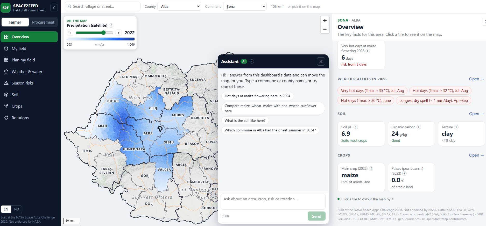

# SPACE2FEED — Field Shift (NASA Space Apps 2026, Alba Iulia)

Decision-support tool for farmers (crop rotations, soil and water) with a procurement
lens for the Transavia **SMART FEED** (pet food) direction: oats, barley, maize, pea,
chickpea, flax, sunflower.

*Built at the NASA Space Apps Challenge. Not endorsed by NASA.*

[Quick live demo](https://cabin-stored-pack-lid.trycloudflare.com/)



## Stack

| Part | Tech |
|---|---|
| Frontend | React + TypeScript (Vite), MapLibre GL |
| Backend | Python 3.12, FastAPI (uv) |
| App data | SQLite (`backend/app.db`, via SQLModel): farms, fields, priorities |
| NASA + geo data | **plain JSON files** in `backend/data/`, loaded once into memory |

## Run

```bash
cd backend && uv sync && uv run uvicorn app.main:app --reload --port 8000
```

```bash
cd frontend && pnpm install && pnpm dev
```

Open http://localhost:5173. Vite proxies `/api` to the backend on port 8000. API docs: http://localhost:8000/docs

## AI assistant

A chat button on the map opens the dashboard assistant. **Its role:** find areas, open
sections, colour the map, and explain the numbers that are already in this dashboard.

- **Deterministic first.** Place names ("zoom to Aiud", "Ineu" → pick one of two), section
  commands ("open soil") and greetings are handled by plain code, no AI involved.
- **Google Gemini** (`gemini-3.8-flash` by default) handles other questions. It can only
  call fixed, read-only tools that run the dashboard's own code over this project's data
  (indicators, season hazards, soil, INS statistics, rotation scores, procurement scores)
  and propose UI actions (select area, open section, colour map). It cannot write, browse
  or fetch anything else.
- **Where it fails:** it can misread a question, pick the wrong commune when names repeat,
  or word a number loosely. Numbers in a reply that do not appear in the tool data are
  flagged with ⚠. Coarse grids (POWER ~50 km, GLDAS ~25 km) describe the region, not a field.
- **Safety:** 500-character messages, per-IP rate limits (6/min, 60/day) and a global daily
  AI budget, prompt-injection screening before the model, signed history (clients cannot
  forge earlier assistant turns), output cleaning (no links/HTML) and a leak canary. The
  API key stays on the server. Messages are not stored.

Enable it by putting the key in `backend/.env` (see `backend/.env.example`):

```bash
S2F_GEMINI_API_KEY=your-key
```

Without a key the assistant still navigates (place names, sections). Run the backend with a
single worker: rate limits are kept in memory.

## My field (drawn fields)

Farmers draw their field on the map (drag a box like a desktop selection, or click its
corners), edit corners, see the area in hectares and save it. Fields from 0.5 ha (warning
under 1 ha) up to 5,000 ha.

Every value says how it relates to the field:

| Kind | Datasets | Resolution | What the field gets |
|---|---|---|---|
| **Measured on the field** | NASA HLS v2.0 NDVI; Sentinel-2 L2A NDVI | 30 m; 10 m | Median of the clear pixels whose centre lies inside the outline, per image date |
| **Model pixel** | ISRIC SoilGrids | 250 m (~4.6 ha) | Value of the pixel(s) under the field; a 1 ha field gets one pixel |
| **Surrounding-area estimate** | GPM IMERG rain; POWER rain / Tmax / hot days; GLDAS root-zone moisture | 11 km; 50 km; 25 km | Value of the native grid cell holding the field, shown with the cell outline and "your field is 0.0004 % of this cell"; never interpolated |
| **Commune average** | SMAP surface soil moisture | 9 km | Only processed per commune here |

- Imagery is read live from the archives (only the pixel window under the field), so the
  first look at a field takes ~2–3 min (whole season Mar–Nov + Jun–Jul of the past 5
  years); results are cached in `backend/.cache/fields/`. Run
  `cd backend && uv run python scripts/prewarm_fields.py` before a demo.
- Every image keeps its date, sensor, tile, scene cloud cover, pixel count and the share of
  clear field pixels. Status: **clear** (≥ 90 % of field pixels clear), **partly cloudy**
  (50–90 %, value flagged), **cloudy** (< 50 %, or scene ≥ 80 % cloud: not read, no value),
  **possible undetected cloud** (value jumps > 0.25 NDVI away from the clear images on both
  sides within 12 days: flagged, not used), **no data**.
- HLS needs an Earthdata login on the server (`~/.netrc` entry for `urs.earthdata.nasa.gov`
  or `S2F_EARTHDATA_TOKEN`); Sentinel-2 needs no account.
- Fields are stored in SQLite (shared, no user accounts). Limits: 200 corners, 64 KB
  request body, 300 saved fields, imagery jobs 4/min and 60/day per IP, 2 jobs at a time.

## Data audit (2026-11-14)

No mock, synthetic or placeholder values are shown anywhere. Every number comes from a
processed public dataset or from code that computes it from one.

- All 23 NASA indicator files carry `status: complete`; none is a sample. The `sample`
  badge in the UI exists but is unused (the old MOD13Q1 AppEEARS sample was replaced by
  MOD13A3).
- `crops/crop_traits.json` is hand-curated literature values (FAO, Ecocrop, IPCC,
  Peoples 2009, Preissel 2015, Seifert 2017) — ranges, not measurements; marked as such.
- Scoring constants (legume pre-crop bonus, repeat penalty, emission factors, score
  scales) are stated assumptions, shown next to every score.
- Explanatory ranges in the (i) texts (e.g. "lowland farmland gets about 550–700 mm") are
  general guidance, not dataset values.
- Gaps: IMERG ends 2025-09; GLDAS 2015-01 is a bad download (empty); SMAP covers ~100
  units around Alba Iulia only; MODIS lacks Vâlcea; the field-level cell files here end
  2025-12 (2026 POWER points live only in the separate raw folder); chickpea uses the
  grain-legume proxy.

## Data layout

```
backend/data/
  geo/      counties, regions, communes, outline, mask, labels (*.geojson.json)
  nasa/     one JSON per dataset; schema in data/nasa/README.md
  crops/    crop traits, INS statistics, EUCROPMAP shares, smart_feed.json
  cells/    native grid cells of IMERG / POWER / GLDAS (for drawn fields)
```

Rebuild the boundary layers (downloads sources into `backend/.cache/`):

```bash
cd backend && uv run --group scripts python scripts/build_boundaries.py
```

## Map

- All 41 counties + București (dissolved from cadastre UATs, so every border level lines up exactly)
- 8 development regions (NUTS-2), coloured with a distinct shade per county
- Commune / town (UAT) borders and labels for Alba + neighbours (Arad, Bihor, Cluj, Hunedoara, Mureș, Sibiu, Vâlcea) from zoom 8
- Everything outside Romania is masked; hillshaded relief

## Data sources & attribution

- Boundaries: [geoBoundaries](https://www.geoboundaries.org) ROU ADM1 (World Bank) / ADM2 (ANCPI), CC BY 4.0
- Commune names (diacritics): © OpenStreetMap contributors, ODbL
- Basemap: [OpenFreeMap](https://openfreemap.org), © OpenMapTiles, © OpenStreetMap contributors
- Terrain: Mapzen / AWS Terrain Tiles
- NASA: POWER daily (MERRA-2 / CERES), GPM IMERG Final V07B, GLDAS Noah 2.1, FIRMS VIIRS S-NPP, MODIS (MOD13A3 NDVI, MOD16A2GF ET, MOD11A2 LST), SMAP L3 Enhanced (SPL3SMP_E), GRACE/GRACE-FO mascons, SRTM GL1
- NASA HLS v2.0 (HLSL30 / HLSS30, LP DAAC) — read live for drawn fields
- Copernicus Sentinel-2 L2A (ESA), via Element 84 Earth Search on AWS — read live for drawn fields
- Satellite basemap for drawing: Sentinel-2 cloudless 2023 by EOX IT Services GmbH (s2maps.eu, CC BY-NC-SA 4.0; contains modified Copernicus Sentinel data 2023)
- ISRIC SoilGrids 2.0 (CC BY 4.0); JRC EUCROPMAP 2018/2022 (CC BY 4.0, © European Union); INS TEMPO Online (AGR108A/109A/110A)
- AI: Google Gemini API (assistant only; answers are generated from the data above)
- Crop traits: FAO (Brouwer & Heibloem 1986; FAO-56), FAO Ecocrop, IPCC 2019 / AR6, Peoples et al. 2009, Preissel et al. 2015, Seifert et al. 2017

Rebuild the processed data from the raw downloads in `backend/.cache/raw/` (see `dataset.md`):

```bash
cd backend && uv run --group process python scripts/process/build_all.py
```
